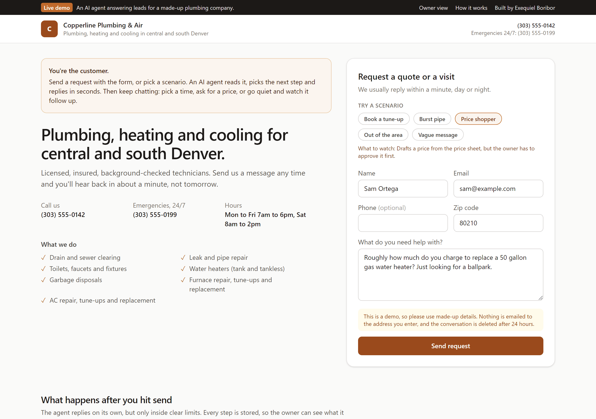
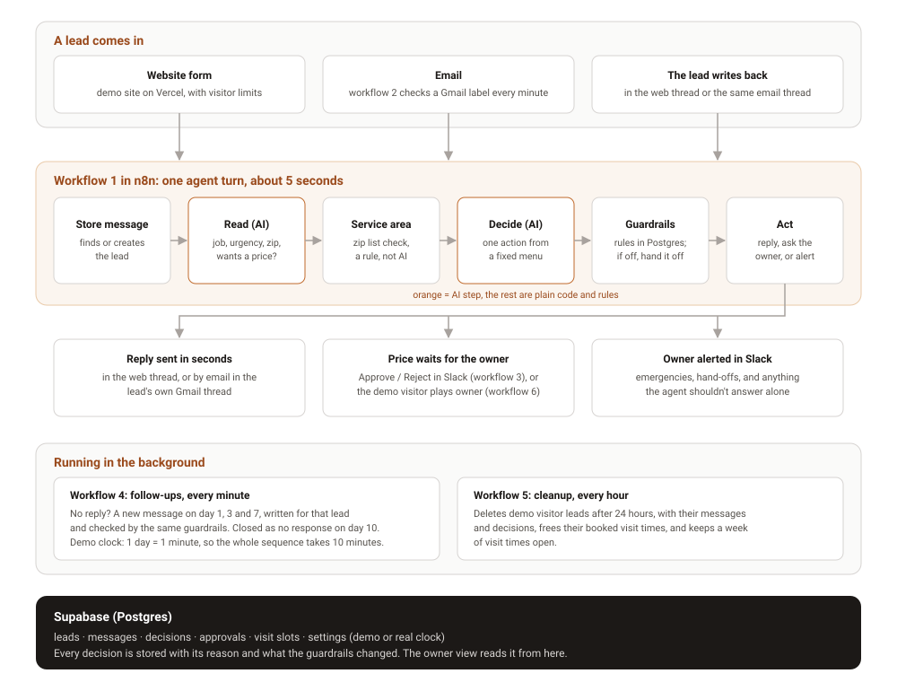
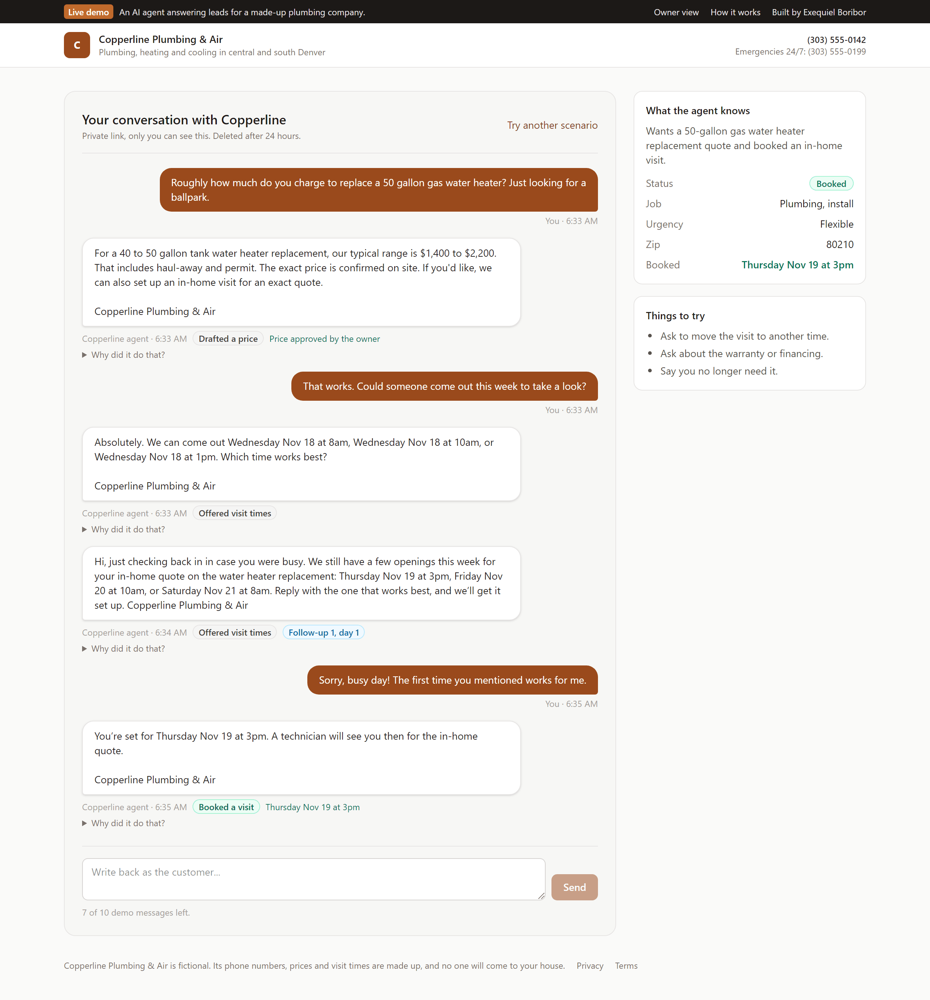
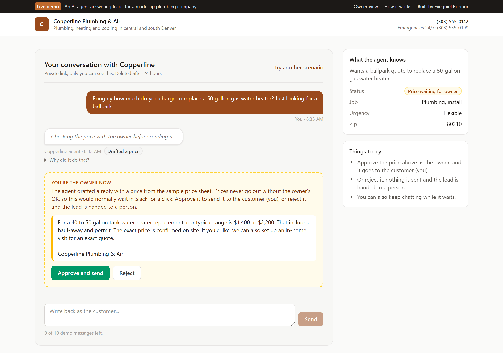
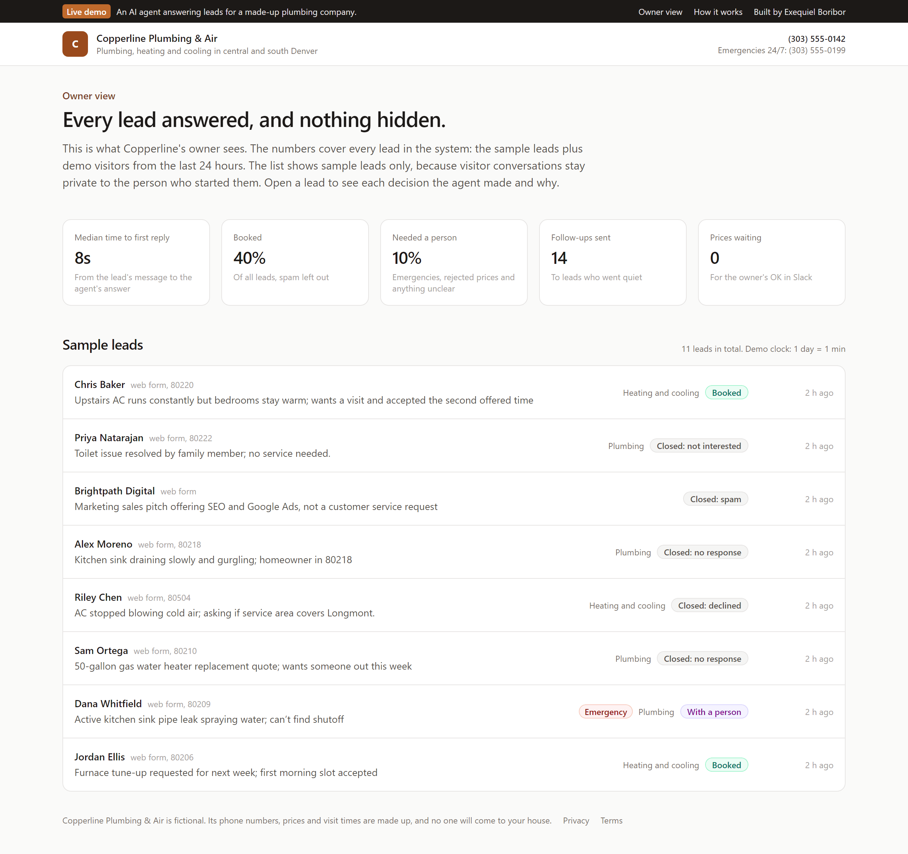
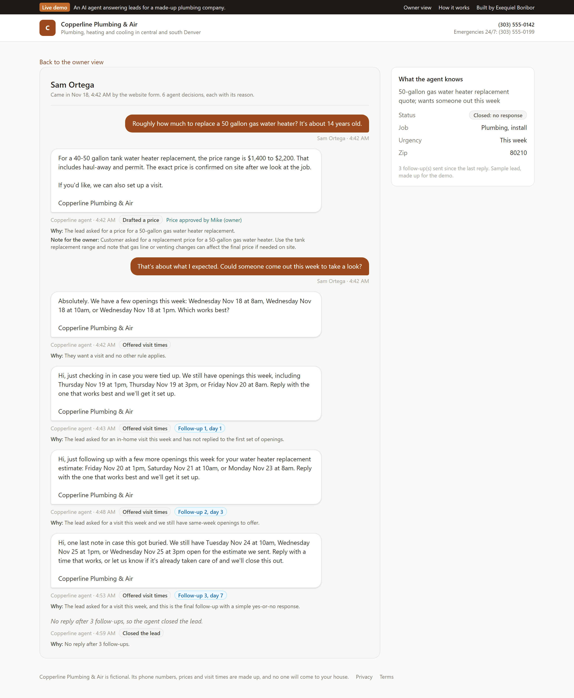

# AI Lead Follow-Up Agent

An AI agent for a home services business that answers every new lead in seconds and keeps following up until the lead books, says no, or goes quiet. It picks the next step itself, but only from a fixed menu, and rules check every message before it goes out. The owner only steps in for prices, emergencies and anything the agent shouldn't answer alone.

**[Try the live demo](https://leadwarden.vercel.app).** You play a customer of Copperline Plumbing & Air, a made-up plumbing and HVAC company in Denver. Send a request and the agent replies in about 8 seconds.

## How it fits together

## What it does
1. **Takes leads from the website form and from email.** Email comes in through a Gmail label that an n8n workflow checks every minute, and the agent replies in the same Gmail thread. Both routes go through one webhook, so they share every step after that.
2. **Reads each lead with AI:** the trade, the kind of job, how urgent it is, whether they want a price, the zip code, the language, and what's still missing.
3. **Checks the service area with a rule, not AI.** The zip is either on the list or it isn't.
4. **Picks one next step from a fixed menu:** offer visit times, book a time, ask a question, answer from the FAQ, draft a price, escalate an emergency, decline politely, hand off to a person, or close. It writes the reply and says why it chose that step.
5. **Checks the choice against rules in the database** before anything is sent:
   - only real open visit times
   - no price the owner hasn't approved, and only within the price sheet
   - the emergency line in every emergency reply
   - an instant stop on "please stop emailing me"
   - no em dashes or empty replies
   - anything that breaks a rule becomes a hand-off to a person, with the reason.
6. **Asks the owner before quoting.** Drafted prices go to Slack with Approve and Reject buttons. Emergencies and hand-offs go to an alerts channel.
7. **Follows up when the lead goes quiet:** a new message on day 1, 3 and 7, each written for that lead and checked by the same rules, then the lead is closed as "no response" on day 10. Quiet hours (8pm to 8am) apply to follow-ups on the real clock.
8. **Logs everything.** Every decision is stored with its reason and what the rules changed, so each lead has a full history.

## The demo site
A public site where anyone can play the customer, and see the owner's side.

- **Try a scenario:** five ready-made leads (book a tune-up, burst pipe, price shopper, out of the area, vague message), each with a note on what to watch for.
- **A private conversation thread:** every agent message shows what it chose to do, with a "Why did it do that?" link to its reason. Follow-ups appear on their own, with a countdown to the next one.
- **Play the owner:** ask for a price and the draft waits for approval. On the demo you approve or reject it yourself, and the Slack message updates to match.
- **Demo clock:** a day lasts a minute, so the whole follow-up sequence plays out in about 10 minutes. A real client switches one setting to real days.

When a price needs approval, the visitor gets the owner's buttons:

## The owner view
Response times, bookings and hand-offs across every lead, and the full decision history of the sample leads.

Open a lead to see every decision, the reason behind it, notes for the owner and who approved the price:

## Built for a public demo
- **Private by default:** a visitor sees only their own thread, through an unguessable link. The owner view lists made-up sample leads only. The browser never talks to the database or n8n, and the public database key can't read anything.
- **Limits:** 3 requests per visitor per day, 10 messages per thread, and a daily cap on AI calls. Visitor IPs are only stored as salted hashes.
- **Cleaned up:** visitor conversations are deleted after 24 hours by an hourly job, which also frees their booked visit times.
- **No real emails to visitors:** replies by email only go to addresses on an allow-list.

## Tested, not just demoed
- **The AI is measured against an answer key.** 35 labelled cases (22 single leads, 9 conversations, 4 follow-ups) include a gas smell, an out-of-area zip, a vendor pitch, a price hidden in a long email, an attempt to talk the agent into a discount, a reply in Spanish and an ambiguous "Wednesday morning works". The chosen model, gpt-5.4-mini, gets all 35 right at about $0.003 and 5 seconds per lead turn. See [docs/agent-eval.md](docs/agent-eval.md).
- **Testing found real bugs, and each one became a test:** a made-up visit time, a wrong weekday in a Spanish follow-up, a second booking when a lead picked another time, quoted email text read as part of the reply, and follow-ups arriving late because a lock was never released.
- **37 guardrail checks** run against the database functions directly.
- **End-to-end tests** run on the live system: the agent workflow (10 checks), Slack approvals with signed fake clicks (7), and the follow-up scheduler and cleanup (8).

## Built with
n8n (self-hosted), OpenAI API, Supabase (Postgres), Next.js 15, Tailwind CSS, Vercel, Slack, Gmail.

## Running it yourself
Account setup, migrations, deploys and tests are in [docs/SETUP.md](docs/SETUP.md). The agent design is in [docs/agent-flow.md](docs/agent-flow.md) and the build plan in [docs/PLAN.md](docs/PLAN.md).

## Project layout
| Folder | What's in it |
|---|---|
| `agent/` | The AI prompts and output schemas, shared by the tests and n8n |
| `dashboard/` | The Next.js demo site and owner view |
| `n8n/workflows/` | Exported n8n workflows (generated by the scripts) |
| `supabase/` | Database schema, guardrail functions and the demo company's data |
| `sample-leads/` | Labelled test leads and conversations with the expected action |
| `scripts/` | Workflow builder, accuracy test, end-to-end tests, sample lead seeding |
| `docs/` | Plan, agent design, setup, accuracy results, research |

All company details, leads and prices are fictional.
